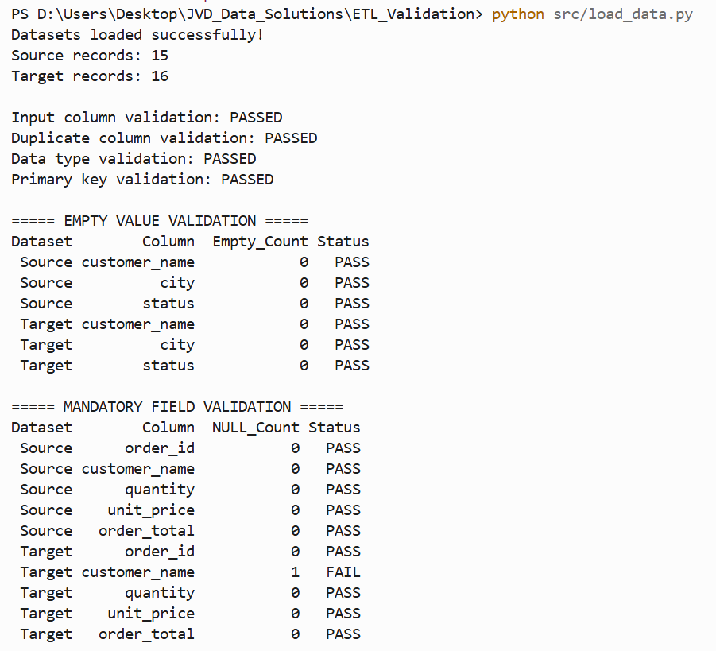
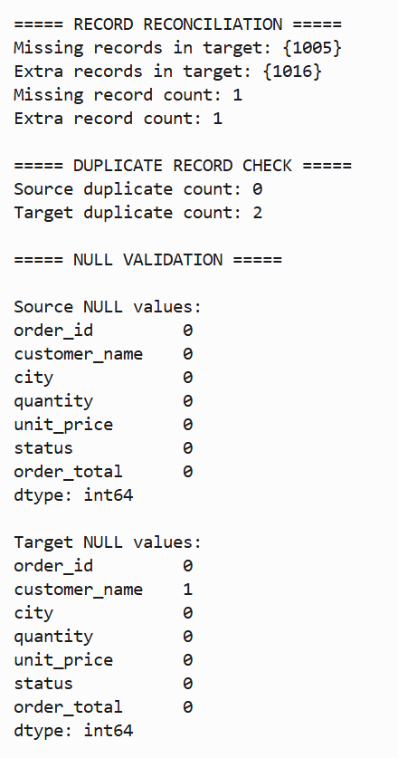
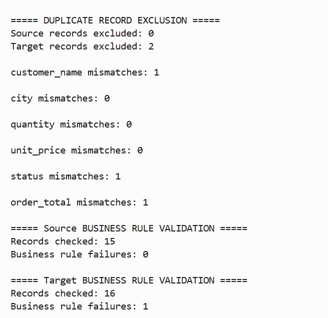
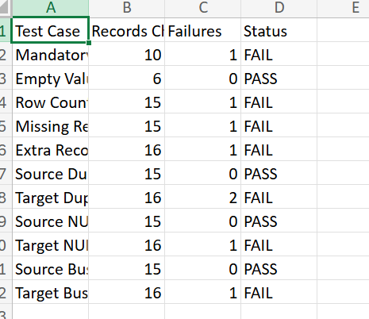
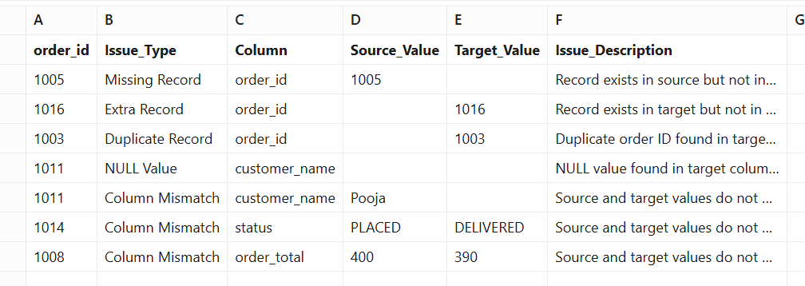
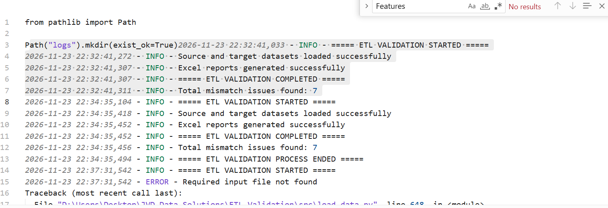

# ETL Data Validation & Reconciliation Framework

## Project Overview

This project is a Python-based ETL Data Validation and Reconciliation framework designed to identify data quality issues between source and target datasets.

It automates record reconciliation, duplicate detection, NULL validation, column-level comparison, business-rule validation, and Excel report generation.

## Technologies Used

- Python
- Pandas
- SQL concepts – data validation and reconciliation
- Excel
- Logging and exception handling

## Project Features

1. Source and target dataset loading (CSV and Excel).
2. Record count validation.
3. Missing and extra record detection.
4. Duplicate primary key detection.
5. NULL and empty-value validation.
6. Mandatory field validation.
7. Column-level source-to-target comparison.
8. Business-rule validation.
9. Automated Excel report generation.
10. Logging and exception handling.

## Project Screenshots

### 1. Project Structure


### 2. Successful Execution




### 3. Validation Summary


### 4. Detailed Mismatch Report


### 5. Business Rule Validation


### 6. Execution Logs

## Project Structure

```text
ETL_Validation/
├── input/
│   ├── source_orders.csv
│   └── target_orders.xlsx
├── src/
│   └── load_data.py
├── output/
│   ├── validation_report.xlsx
│   └── mismatch_records.xlsx
├── logs/
│   └── etl_validation.log
└── README.md
```

## How to Run the Project

### 1. Install Python dependencies

```bash
pip install pandas openpyxl
```

### 2. Run the validation script

```bash
python src/load_data.py
```

### 3. Review generated reports

After execution, check the `output/` folder for:

- `validation_report.xlsx` – validation summary and business-rule results.
- `mismatch_records.xlsx` – detailed data mismatch findings.

Execution logs are available in `logs/etl_validation.log`.

## Sample Validation Results

The demonstration dataset contains:

- 15 source records.
- 16 target records.
- 1 missing record.
- 1 extra record.
- 2 duplicate target rows.
- 1 NULL mandatory field.
- 3 column-level mismatch findings.
- 1 target business-rule failure.

These are intentional issues in the synthetic demonstration data.

## Business Rule Example

Order total validation:

```python
expected_total = quantity * unit_price
```

The framework identifies records where the actual order total differs from the expected total.

## Portfolio Note

This project uses synthetic demonstration data and is intended to showcase practical ETL testing, data reconciliation, and Python automation skills.

## Author

Dayananda Data Solutions

**Specialization:** ETL Testing | SQL Data Validation | Python Automation | Data Quality Assurance